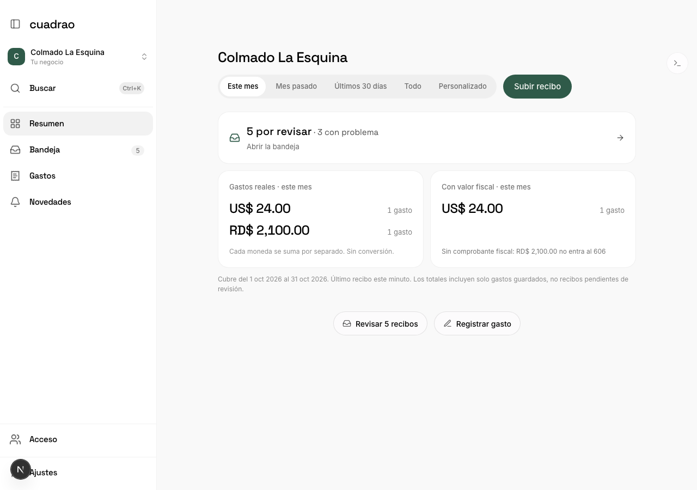
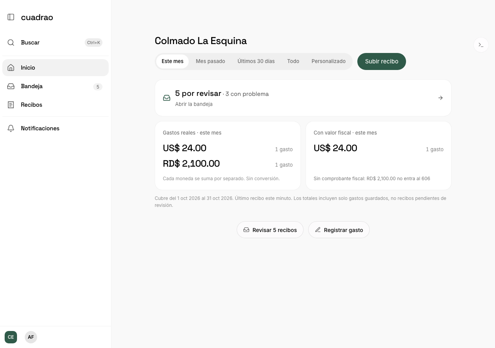
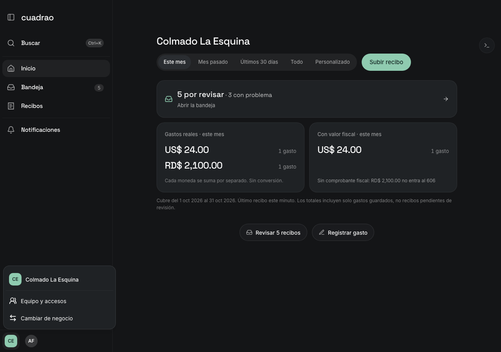
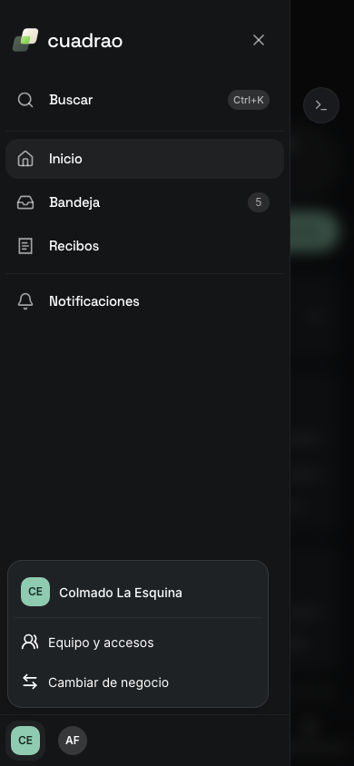
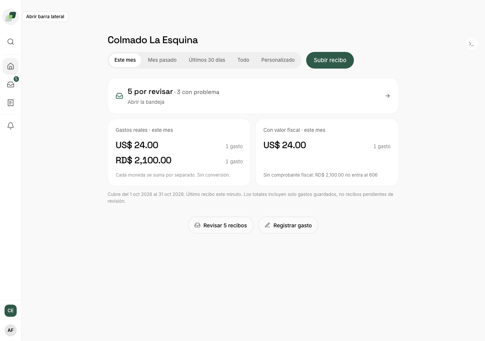

# Business sidebar polish

The Business sidebar keeps its logo and pins Search, Home, Inbox, Receipts and Notifications at the top. The business mark and person initials have separate 44px targets at the bottom. The business menu opens the existing access panel and offers the existing business list only when at least two businesses are available. Business names still come from `GrantedSpace`.

Owner is `codex/biz-sidebar-polish`. The original integration base was `955b96b16133883fff3008604065583ff6294bb3`. The lane then merged integration `44613adca5085c5afa74fbde4b4932b45a8cfd1c` one way, including the settings cleanup. The merge was clean and preserved both complete ownership entries. `ProfileMenu.tsx` is byte-identical to that integration tip.

The current account API has no picture field. The profile target shows the person's actual initials. This lane adds no photo upload or invented image. The sidebar choice is saved per person in the existing browser-storage registry under its layout category. Personal keeps its existing preference and temporary toggle behavior. This is device-local, not a new server setting.

Model the Domain kept the menu in one `menu | switcher | null` state and kept the server's grant list as the name owner. Prove It Works required rendered navigation, geometry and keyboard checks instead of relying on compilation.

## Verification

All browser proof is local, using the real `/biz` components and intercepted fixture responses. The browser rejects every request outside localhost. It makes no hosted, paid or model call.

- `cd web && bun test __tests__` passed 2665 tests across 278 files.
- `NEXT_PUBLIC_BUSINESS_PILOT_ENABLED=true PLAYWRIGHT_PORT=3119 CUADRAO_SIDEBAR_EVIDENCE_DIR=../docs/reports/evidence/biz-sidebar-polish bunx playwright test e2e/business-sidebar-polish.spec.ts --workers=1` passed 5 tests.
- The browser probe opens Search, all four destinations, access, the business list and profile settings. It selects a real named business, checks Escape focus return, omits switching for one business, reloads a collapsed rail and checks the retained inbox count. Light and dark phone drawers keep separate 44px targets. Navigation and menu icons use 20px with a 2px stroke. Reduced motion disables the hover transition.
- `business-sidebar-preference.dom.test.tsx` tests first-visit expansion, different people's saved modes and Personal behavior. `business-sidebar-preference.test.ts` tests malformed storage and identity initials. `business-switcher.dom.test.tsx` tests access, exact saved names, keyboard selection and grant IDs. Existing locked-polish tests now enter access through the business menu.
- `bun run build` passed, including the application's TypeScript check. Raw `tsc --noEmit` includes the repository's existing incompatible test typings, so it is not the application gate.
- Focused ESLint passed with two existing unused-destructuring warnings in `ChatSidebar`. `git diff --check` and the modularity budget passed.

The combined tree passed 30 focused sidebar, preference and settings tests. The preview regression also passed twelve business switches with a receipt and typed draft, plus preserving an Overview draft across Inbox navigation (2 browser tests). The five sidebar browser cases and production build were repeated after reconciliation.

The initial browser checks exposed a ref lost through the tooltip wrapper. Keeping the actual button ref below the wrapper fixed Escape focus and placement. Screenshot and geometry assertions use the actual rendered DOM. Devtools chrome is hidden only in the test.

## Shared files

`BusinessWorkspace` changes only the sidebar and header slots. `ChatInterface` moves only the sidebar preference state to a hook and supplies the existing account to the profile trigger. `ChatSidebar` changes only the Business footer identity placement. `SidebarNavButton` adds a collapsed count and calm motion. `browser-storage` adds one declared layout entry. The owning settings and business-name Evals must re-check these shared slots before landing. No naming prompt, settings content, API health, data, grants or loading screen changes are included.

The detection signal is the committed navigation and preference regression tests, plus existing request failures. This lane adds no analytics event or tracking.

## Screenshots

The before images show integration's previous sidebar in both themes. The after images show the expanded and collapsed rail, the business menu and the phone drawer in both themes.

